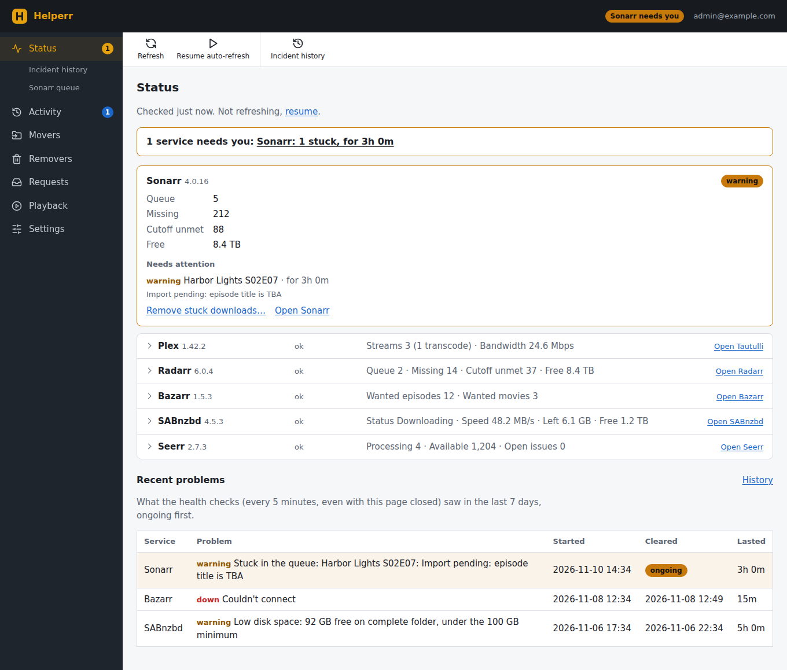
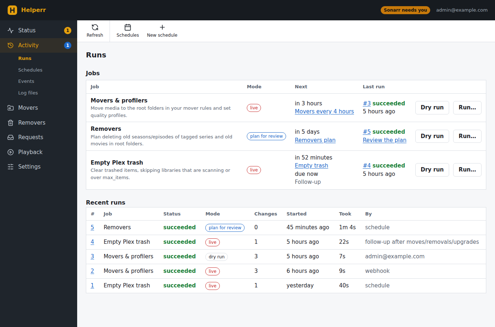
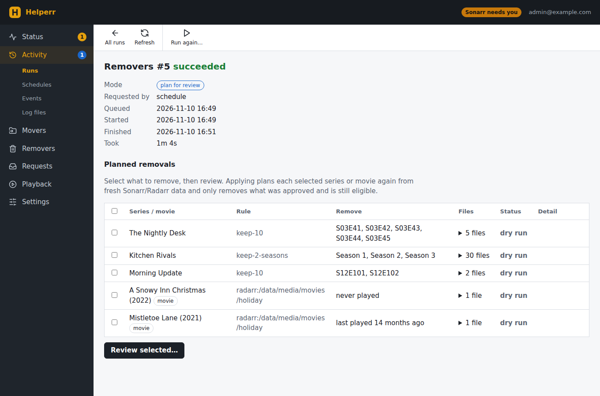
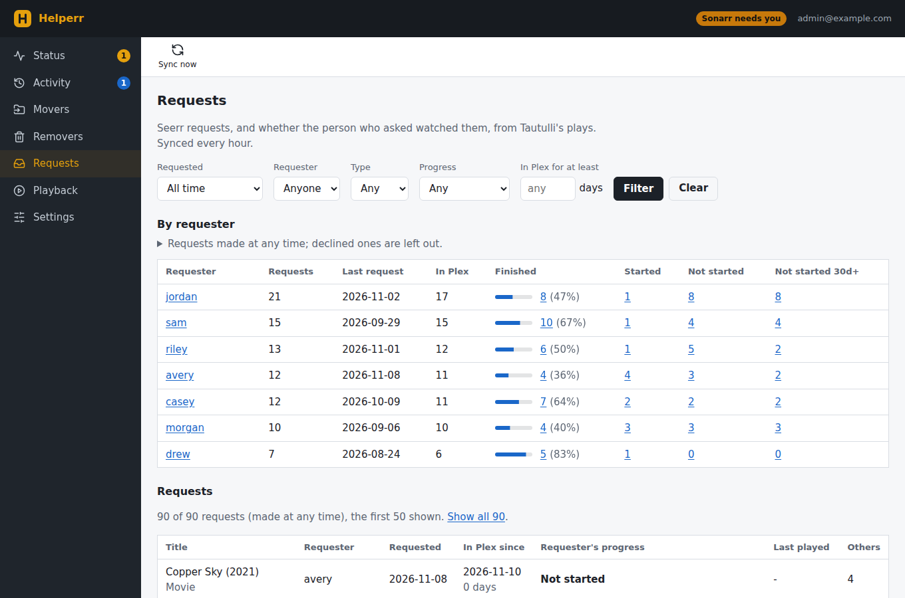
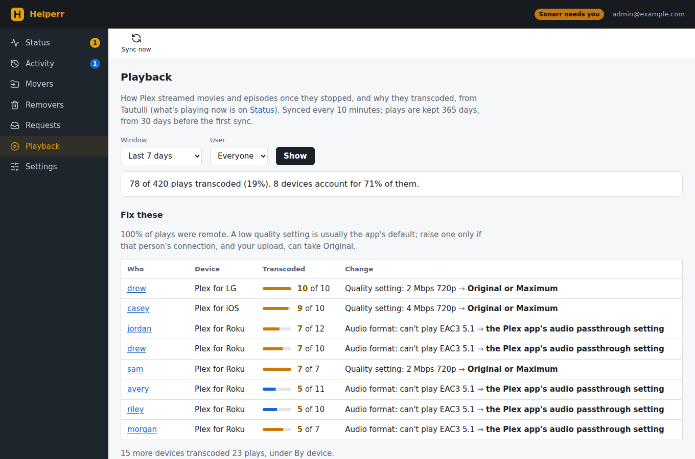

# Plex Library Helperr

This started as a script to move documentaries in Radarr to their own folder and library. It grew from there. Version 2 adds a web app, so I can keep an eye on my Plex setup and run jobs from one place instead of logging into Radarr, Sonarr, Seerr and SABnzbd one by one.

It does four kinds of jobs against Radarr and Sonarr:

- **Movers** move movies or series to a different root folder based on genre, tag, studio, network or certification. I use these to split things like documentaries, kids shows and holiday movies into their own Plex libraries.
- **Profilers** set the quality profile of matching movies or series. I mostly use this as a hack to quietly block certain requests: the profile they get can never be met, so they never download.
- **Removers** clean up old stuff. For Sonarr they delete old seasons or episodes of tagged series and keep the latest ones (good for daily shows). For Radarr they delete old movies from a root folder.
- **Empty trash** empties the Plex trash, for servers with "Empty trash automatically after every scan" turned off. It skips any library that's scanning or has a suspiciously full trash.

The web app adds a status page for all your services, request and watch stats, and playback quality stats. More on those below.

**Test with dry run on until you like the results.** A new install starts in dry run.

## Screenshots

All of the data in these is made up.

**Status.** One line tells you if anything needs you. Services with problems get a card, healthy ones get one line.



**Runs.** Every job, when it runs next, and how its last run went.



**Removers plan.** Removers never delete on their own. Each run makes a plan and you pick what to remove.



**Requests.** Who requested what, and whether they actually watched it.



**Playback.** Who is transcoding, on which device, and what to change to fix it.



## What the web app does

- **Status:** what Plex (through Tautulli), Radarr, Sonarr, SABnzbd, Bazarr and Seerr are doing right now. Health warnings, stuck downloads, failed downloads, low disk space, who's streaming. Stuck downloads can be removed from here, the same way you would in Radarr or Sonarr. Health checks run every 5 minutes in the background and keep a history of problems for a year.
- **Runs and schedules:** run any job by hand (with a **Dry run** button or a **Run...** button that asks first), or on a cron schedule. Every run is kept with what it changed and its log.
- **Removers:** each run plans what it would delete. You review the plan, tick what to remove, and confirm. Once you trust a rule you can turn on auto-approve for it.
- **Webhooks:** point Radarr's and Sonarr's webhook at the app and movers run as soon as something is added, before it downloads. File upgrades queue a trash empty a little later.
- **Requests:** every Seerr request, who made it, when it reached Plex and how much of it they watched. Uses Tautulli's history.
- **Playback:** how each play was streamed and why it transcoded (quality setting, audio format, subtitles, HDR and so on), grouped by person and device with what to change.
- **Settings:** everything is set up in the app, including connections (with a Test button) and rules (with a Preview button that shows what a rule would match before you save it). Every save is kept as a version you can compare and restore.
- **Events and logs:** the app's log, viewable and downloadable from the app.
- **JSON API:** most pages have a matching `/api/...` endpoint (runs, schedules, config, status, requests, playback).

## Upgrading from version 1

Version 1 read `config.toml`. Version 2 doesn't. Settings live in the app's database and are edited on the Settings pages, so set up the web app first and enter your connections and rules there. The command line jobs still work, but they read the same database (see [Running jobs without the web app](#running-jobs-without-the-web-app)).

## Setup (Docker on Unraid)

The image is `ghcr.io/ryanthornburg/plex-library-helperr:latest`. Every push to `mainline` runs the tests and publishes it, along with a `sha-<commit>` tag you can pin or roll back to.

The web app only accepts requests that come through [Cloudflare Access](https://developers.cloudflare.com/cloudflare-one/policies/access/). It checks every request for a valid Access token and your email, and it won't start without those settings. It's reached through a Cloudflare Tunnel, so the container publishes no port and nothing on your router points at it.

### 1. Cloudflare

1. **Tunnel:** Zero Trust > Networks > Tunnels > Create a tunnel (Cloudflared). Pick Docker and copy the token from the command it shows.
2. **cloudflared container** on the Docker tab:

    | Field | Value |
    |---|---|
    | Repository | `cloudflare/cloudflared:2026.10.1` (pin a version) |
    | Network Type | A custom Docker network, the same one the web app will use |
    | Post Arguments | `tunnel --no-autoupdate run` |
    | Variable | `TUNNEL_TOKEN` = the token from step 1 |

3. **Public hostname** on the tunnel, e.g. `helperr.example.com`, pointing at `http://plex-library-helperr:8080`.
4. **Access application:** Zero Trust > Access > Applications > Add > Self-hosted, for the same hostname. Add an Allow policy with only your email. Copy the **Audience (AUD) tag** from its overview.

### 2. Web container

| Field | Value |
| --- | --- |
| Name | `plex-library-helperr` (the tunnel points at this name) |
| Repository | `ghcr.io/ryanthornburg/plex-library-helperr:latest` |
| Network Type | The same network as cloudflared |
| Extra Parameters | `--read-only --cap-drop ALL --security-opt no-new-privileges` |
| Post Arguments | `--serve` |
| Path | `/config` > `/mnt/user/appdata/plex-library-helperr/config` |
| Ports | none |
| Variable `CF_ACCESS_TEAM_DOMAIN` | `<team>.cloudflareaccess.com` |
| Variable `CF_ACCESS_AUD` | The AUD tag from step 4 |
| Variable `ALLOWED_EMAILS` | Your Access email (comma separated for more than one) |
| Variable `HELPERR_SECRET_KEY` | 32 or more random characters, e.g. `openssl rand -hex 32`. Encrypts the API keys in the database. Keep a copy, without it you have to enter the keys again. Mark it masked. |
| Variable `REMOVERS_ALLOW_APPLY` | `true` to allow removers to delete anything. Off by default. It's an environment variable so nothing in the app can turn it on. |

The database (`helperr.db`) and logs go in `/config`. Keep it on a cache pool, not the array, since SQLite and Unraid's FUSE layer don't get along. If the container can't write there, `chown 99:100` the folder.

Service URLs can't use `localhost` (inside the container that's the container itself). Use the server's IP, or the container name (e.g. `http://sonarr:8989`) if Helperr is on the same Docker network.

### 3. In the app

1. **Settings > Connections:** add Radarr, Sonarr, Plex and whatever else you use (Tautulli, Seerr, SABnzbd, Bazarr, Autoscan) and hit Test on each.
2. **Movers** and **Removers:** add your rules. Use Preview to see what a rule matches.
3. **Activity > Schedules:** add schedules. New ones force dry run until you turn that off.
4. **Settings > Webhook** (optional): shows the URL and API key to put in Radarr's and Sonarr's Connect > Webhook. Turn on *On Movie Added* / *On Series Add*, and *On File Upgrade* if you want trash emptied after upgrades. Put the key in an `X-Api-Key` header.
5. When the dry runs look right, turn dry run off in Settings. The app asks you to confirm anything that makes a job live.

## Removers and deleting files

Removers are the one part that deletes media, so they're careful:

- A removers run only makes a plan. Nothing is deleted until you approve the plan on the run's page, or turn on auto-approve for that rule.
- Applying a plan checks everything again with fresh data. Anything watched, replaced, downloading or no longer old enough since the plan was made is skipped.
- A plan can only be applied once, and only within 7 days.
- `max_deletes` stops the whole run if it would delete more files than that.
- Nothing is deleted unless the container has `REMOVERS_ALLOW_APPLY=true`.

How the rules work:

**Sonarr** (`[[sonarr.removers]]`, picked by series tag):

- `seasons` mode removes whole seasons, and only when every file in the season is older than `min_age`. `episodes` mode works per file.
- `keep` is how many of the latest seasons or episodes to always keep. Only ones with files count. Specials never count, and are only removed with `include_specials`.
- Age counts from when Sonarr first imported the episode, so a file that was upgraded or lost and found again doesn't start over.
- `skip_if_watched_within` keeps anything someone watched recently, plus everything after it. Watching the newest episodes never blocks removal of old ones.
- A series is skipped if it was added recently, has something downloading, or Sonarr returns bad data.
- Episodes are unmonitored first so Sonarr doesn't download them again.

Example: `type = seasons`, `keep = 2`, `min_age = 90d` on a show with seasons 1 to 5 removes seasons 1 to 3 once all their files are over 90 days old.

**Radarr** (`[[radarr.removers]]`, picked by root folder):

- A movie is removed once it was both added to Radarr and released longer ago than `min_age`.
- `skip_if_ever_watched` keeps anything anyone ever played. `skip_if_watched_within` keeps anything played recently. Plays come from Tautulli, so these need Tautulli connected.
- The movie is deleted from Radarr with its files, without an import exclusion.

## Empty trash

Movers and removers only trigger a Plex scan, which puts the old files in the trash. Emptying it is a separate job. With the web app it runs on its own about 15 minutes after a live run moves or removes something, or after an upgrade, so you don't have to schedule it often.

Before emptying it checks each library. It skips one that's scanning, one with more than `max_items` in the trash, or one where more than `max_deleted_items` items are fully gone without Helperr's removers having deleted them. A missing mount makes Plex trash a whole library, and this keeps that from wiping it.

## Running jobs without the web app

`main.py` can still run one job and exit. It uses the web app's database, so it needs the same `/config` folder and `HELPERR_SECRET_KEY`.

```bash
uv sync                         # install dependencies
uv run main.py                  # movers and profilers
uv run main.py --remove         # removers (plans only, never deletes from here)
uv run main.py --empty-trash    # empty Plex trash
uv run main.py --serve          # the web app
```

In Docker, run the same image with `--remove` or `--empty-trash` as the Post Arguments, Autostart off, and start it when you want the job to run. Each run ends with a summary and exits with status 1 if anything failed.

Outside Docker, set `DATA_DIR` to keep `helperr.db` and `logs/` somewhere other than the repo.

## Settings reference

Everything here is edited in the app. These are the names behind the forms, which also show up in error messages (like `[[radarr.movers]] #2`) and in `GET`/`PUT /api/config`.

### General

| Key | What it does |
| --- | --- |
| `dry_run` | Preview changes without making them (default: on). Radarr, Sonarr and empty trash can each override it. |
| `filter_time` | Movers and profilers only look at media added within this window, e.g. `7d`, `12h`. Empty means the whole library. |
| `followup_delay` | How long after a live move, removal or upgrade to empty the trash (default `15m`) |
| `followup_attempts` | How many times to retry when that empty trash is blocked, `0` turns it off (default `3`) |
| `plan_max_age` | A removers plan older than this can't be applied (default `7d`) |
| `min_free_gb` | Warn on Status when a root folder or SABnzbd folder has less free space than this (default `100`, `0` is off) |

### Movers

Rules run in order and the first match wins. Each needs at least one of genres, tags, studios, networks or certifications.

| Key | What it does |
| --- | --- |
| `path` | Root folder to move matches into |
| `genres` / `genre_match` | Genres to match, `any` or `all` |
| `tags` / `tag_match` | Tags to match, `any` or `all` |
| `certifications` | Ratings to match, e.g. `G`, `PG` |
| `studios` | Studios to match (Radarr only) |
| `networks` | Networks to match (Sonarr only) |
| `exclude_genres`, `exclude_tags`, `exclude_certifications`, `exclude_paths` | Skip anything with these |
| `plex_library` | Plex library to refresh after moving, when Autoscan isn't set up |

Each Radarr and Sonarr section can also add a `tag` to everything a mover moves.

### Profilers

| Key | What it does |
| --- | --- |
| `profile` | Quality profile to set |
| `titles` | Titles to match |
| `studios` / `networks` | Studios (Radarr) or networks (Sonarr) to match |
| `monitored` | Also set monitored on or off. Leave empty to not change it. |

### Sonarr removers

| Key | What it does |
| --- | --- |
| `type` | `seasons` or `episodes` |
| `keep` | How many of the latest seasons or episodes to keep |
| `tags` | Series with any of these tags use this rule. A tag can only belong to one rule. |
| `exclude_tags` | Skip series with these tags |
| `min_age` | Required. Only remove what was first imported longer ago than this, e.g. `90d` |
| `include_specials` | Also remove specials |
| `skip_if_watched_within` | Keep anything watched within this window |
| `plex_library` | Plex library to refresh after, when Autoscan isn't set up |

### Radarr removers

| Key | What it does |
| --- | --- |
| `path` | Required. The root folder this rule cleans up. One rule per folder. |
| `min_age` | Required. Remove movies added and released longer ago than this, e.g. `730d` |
| `exclude_tags` | Skip movies with these tags |
| `skip_if_ever_watched` | Keep anything that's ever been played |
| `skip_if_watched_within` | Keep anything played within this window |
| `plex_library` | Plex library to refresh after, when Autoscan isn't set up |

Each *arr also has `max_deletes`: if a run would delete more of its files than this, it deletes none of them.

### Empty trash settings

| Key | What it does |
| --- | --- |
| `libraries` | Which Plex libraries to empty. Empty means every movie and TV library. |
| `max_items` | Skip a library with more than this many items in the trash (default `100`) |
| `max_deleted_items` | Skip a library with more than this many fully deleted items that Helperr's removers didn't delete (default `50`) |
| `dry_run` | Override the general dry run for this job |

### Autoscan

With Autoscan set up, movers and removers send the old and new folders to Autoscan instead of refreshing whole Plex libraries. Paths are sent the way Radarr and Sonarr see them. If Plex sees them differently, add a rewrite on your Autoscan Plex target:

```yaml
targets:
  plex:
    - url: http://192.168.1.10:32400
      token: xxxxx
      rewrite:
        - from: /data/media/
          to: /mnt/media/
```

### Connections

Radarr, Sonarr, Plex, Tautulli, Seerr, SABnzbd, Bazarr and Autoscan each take a URL and an API key (or token). Most also take a `public_url`, which is what the Status page links to when you're away from home. Bazarr's URL needs its base URL if it has one, e.g. `http://bazarr:6767/subs`.

Keys are encrypted with `HELPERR_SECRET_KEY` before they're saved, are never shown again, and are left out of the settings history. Leave a key field empty to keep the saved one.

You can also add links to other tools (like Tracearr) under Settings > Connections > Other links, and they'll show up on the Status page.

## Development

Needs Python 3.14 and [uv](https://github.com/astral-sh/uv).

```bash
uv sync
uv run pytest tests/ -v
docker build -t plex-library-helperr .
```

I used Claude to help write the tests.
