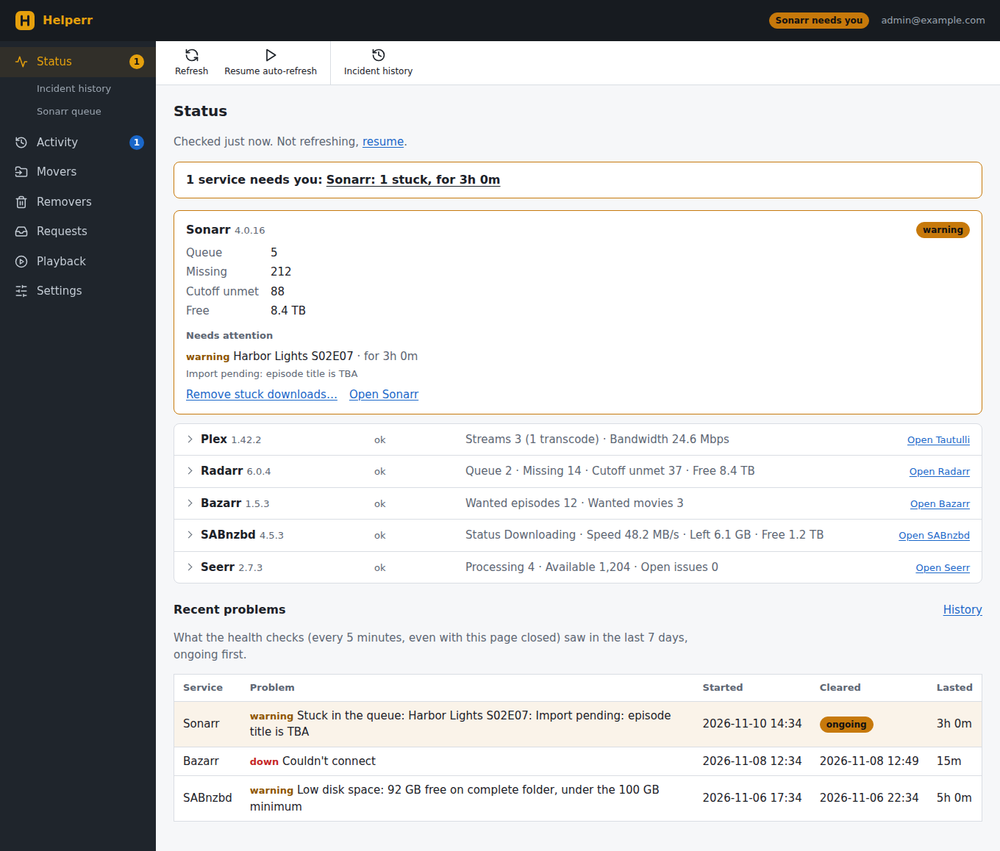

# Plex Library Helperr

[](https://github.com/RyanThornburg/plex-library-helperr/actions/workflows/docker.yml)

Plex Library Helperr is a web app for keeping an eye on a Plex setup and looking after its library from one place, instead of logging into Radarr, Sonarr, Seerr and SABnzbd one by one.

It started as a script to move documentaries in Radarr to their own folder and library, and grew from there. Other tools do some of this ([Kometa](https://github.com/Kometa-Team/Kometa), [Maintainerr](https://github.com/Maintainerr/Maintainerr)), but I couldn't find one that fit my setup.



## Features

### Watching your setup

- **Status:** what Unraid, Plex (and the machine it runs on), Radarr, Sonarr, SABnzbd, Bazarr, Seerr and Kometa are doing now, with one line saying whether anything needs you. Checked every 5 minutes, with a year of problem history.
- **Stuck downloads:** remove downloads Radarr and Sonarr won't finish, by hand or automatically.
- **Library:** what nobody watches, by library, type and requester.
- **Requests:** who requested what in Seerr, and whether they watched it.
- **Playback:** who is transcoding, on which device, and what to change to fix it.
- **Assistant:** ask Claude about a problem in plain words. It investigates your services and proposes a fix you confirm (needs an Anthropic API key).

### Jobs

Run by hand or on a schedule, each with a dry run:

- **Movers:** move movies or series to another root folder by genre, tag, studio, network or rating, as soon as Radarr or Sonarr adds them.
- **Profilers:** set the quality profile of matching movies or series.
- **Removers:** clean out old seasons, episodes and movies, planned for your review first.
- **Duplicate versions:** remove extra copies Plex has of the same movie or episode.
- **Empty trash:** empty Plex's trash safely, for servers with automatic emptying turned off.
- **TRaSH Guides sync:** keep custom formats, quality profiles and quality sizes in line with [TRaSH Guides](https://trash-guides.info/), reviewed before anything changes.

Everything is set up in the app, with a Test button for connections, a Preview button for rules and a history of every settings change. Every page needs a sign-in (a password, or Cloudflare Access), and most have a JSON API.

## Safe by default

- A new install starts in **dry run**. Turning a job live always asks you to confirm.
- Anything that deletes media only **plans**. You review the plan and pick what goes, or turn on auto-approve for a rule you trust.
- Deleting also needs `REMOVERS_ALLOW_APPLY=true` on the container, which nothing in the app can turn on.

## Getting started

The image is `ghcr.io/ryanthornburg/plex-library-helperr:latest`.

```bash
docker run -d --name plex-library-helperr \
  --read-only --cap-drop ALL --security-opt no-new-privileges \
  -p 8780:8080 \
  -v /mnt/user/appdata/plex-library-helperr/config:/config \
  -e HELPERR_SECRET_KEY=your-secret-key \
  ghcr.io/ryanthornburg/plex-library-helperr:latest --serve
```

`HELPERR_SECRET_KEY` is 32 or more random characters (`openssl rand -hex 32`) and encrypts the API keys you enter in the app, so keep a copy. The container's log has a setup token for creating your login.

- [Installation](https://github.com/RyanThornburg/plex-library-helperr/wiki/Installation): the Unraid template, image tags, password or Cloudflare sign-in, and upgrading from version 1.
- [Getting Started](https://github.com/RyanThornburg/plex-library-helperr/wiki/Getting-Started): connect your services and do your first dry runs.
- [Wiki](https://github.com/RyanThornburg/plex-library-helperr/wiki): every page of the app with screenshots, the [settings reference](https://github.com/RyanThornburg/plex-library-helperr/wiki/Settings-Reference), the [API](https://github.com/RyanThornburg/plex-library-helperr/wiki/API) and [troubleshooting](https://github.com/RyanThornburg/plex-library-helperr/wiki/Troubleshooting).

What changed in each release is in [CHANGELOG.md](CHANGELOG.md).

## Support and contributing

This is a personal project built around my own setup, but bug reports, ideas and questions are welcome as [issues](https://github.com/RyanThornburg/plex-library-helperr/issues). See [CONTRIBUTING.md](CONTRIBUTING.md) for what to include and how to run it from source.

I used Claude to help write the tests for version 1 (the command line script), and heavily for the move to the web app (version 2).

## License

[GPL-3.0 or later](LICENSE). The icons in `web/static/icons.svg` are from [Lucide](https://lucide.dev) (ISC).
