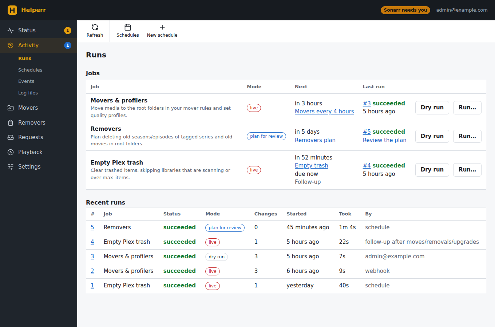
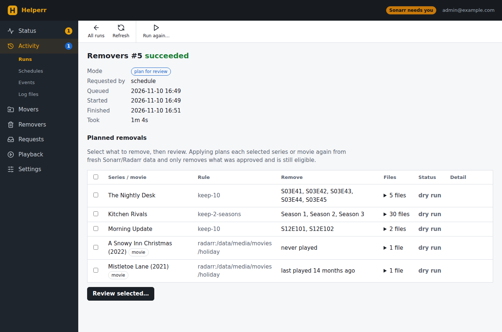
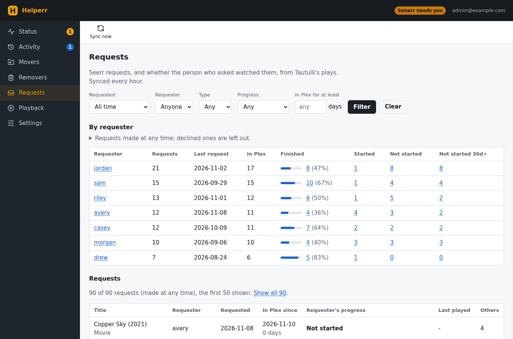
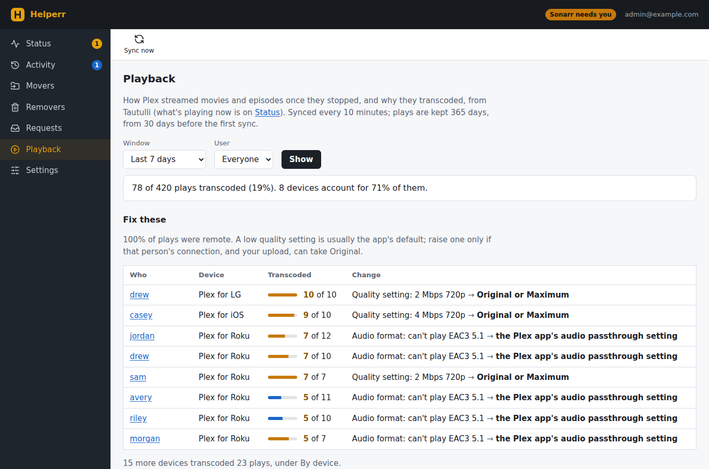

# Plex Library Helperr

This started as a script to move documentaries in Radarr to their own folder and library. It grew from there. Version 2 adds a web app, so I can keep an eye on my Plex setup and run jobs from one place instead of logging into Radarr, Sonarr, Seerr and SABnzbd one by one.

There are likely services out there that do some of this ([Kometa](https://github.com/Kometa-Team/Kometa), [Maintainerr](https://github.com/Maintainerr/Maintainerr)) if not all of it, but I couldn't find one that fits my needs.

It does four kinds of jobs against Radarr and Sonarr:

- **Movers** move movies or series to a different root folder based on genre, tag, studio, network or certification. I use these to split things like documentaries, kids shows and holiday movies into their own Plex libraries.
- **Profilers** set the quality profile of matching movies or series. I mostly use this as a hack to quietly block certain requests: the profile they get can never be met, so they never download.
- **Removers** clean up old stuff. For Sonarr they delete old seasons or episodes of tagged series and keep the latest ones (good for daily shows). For Radarr they delete old movies from a root folder.
- **Empty trash** empties the Plex trash, for servers with "Empty trash automatically after every scan" turned off. It skips any library that's scanning or has a suspiciously full trash.

The web app adds a status page for all your services, request and watch stats, and playback quality stats. More on those below.

**Test with dry run on until you like the results.** A new install starts in dry run.

The [wiki](https://github.com/RyanThornburg/plex-library-helperr/wiki) walks through every page with screenshots: installing, first dry runs, syncing TRaSH Guides, reviewing removers and the rest.

## Screenshots

All of the data in these is made up.

**Status.** One line tells you if anything needs you. Services with problems get a card, healthy ones get one line.


**Runs.** Every job, when it runs next, and how its last run went.



**Removers plan.** Removers never delete on their own. Each run makes a plan and you pick what to remove.



**Requests.** Who requested what, and whether they actually watched it.



**Playback.** Who is transcoding, on which device, and what to change to fix it.



## What the web app does

- **Status:** what Unraid, Plex (through Tautulli), Radarr, Sonarr, SABnzbd, Bazarr, Seerr and Kometa are doing right now. Health warnings, stuck downloads, failed downloads, low disk space, who's streaming. For Unraid: the array, each disk's state, errors, temperature and fill level (against the thresholds you set in Unraid), parity checks, containers set to autostart that aren't running, the UPS (on battery, charge, runtime left), and Unraid's own warnings and alerts (SMART warnings among them). Stuck downloads can be removed from here, the same way you would in Radarr or Sonarr, or automatically once they've been stuck a while. Health checks run every 5 minutes in the background and keep a history of problems for a year.
- **Runs and schedules:** run any job by hand (with a **Dry run** button or a **Run...** button that asks first), or on a cron schedule. Every run is kept with what it changed and its log.
- **Removers:** each run plans what it would delete. You review the plan, tick what to remove, and confirm. Once you trust a rule you can turn on auto-approve for it.
- **Duplicate versions:** finds movies and episodes with more than one version in Plex, for example when Radarr or Sonarr re-downloaded files from a disk that dropped out and the old copies came back. It plans deleting every version that isn't the file Radarr/Sonarr tracks, for you to review the same way as removers. It skips anything it can't be sure of: a file added in the last few days, a download in progress, a version much longer or shorter than the tracked one (it may be another episode or cut), or a file holding several episodes. Deleting goes through Plex, which needs Settings > Library > Allow media deletion turned on.
- **Webhooks:** point Radarr's and Sonarr's webhook at the app and movers run as soon as something is added, before it downloads. File upgrades queue a trash empty a little later. Kometa's webhooks report its runs and errors to the Status page.
- **Library:** every movie, show and season in Plex with everyone's plays of it, to find what nobody watches: never watched since it was added, or not watched in a while (180 days unless you pick another number). Filter by library, type and requester, show TV a row per season, see counts per requester and per library, and download the list as CSV. Uses Tautulli's history, Plex, and Seerr for who asked for what.
- **Requests:** every Seerr request, who made it, when it reached Plex and how much of it they watched. Uses Tautulli's history.
- **Playback:** how each play was streamed and why it transcoded (quality setting, audio format, subtitles, HDR and so on), grouped by person and device with what to change.
- **Assistant:** ask Claude about a problem in plain words ("S03E04 of The Bear won't play", "why didn't this movie download?") and it investigates: Radarr's and Sonarr's files, history and queue, SABnzbd, Plex's versions and files, Tautulli's plays, Bazarr, Seerr's reported issues, and Helperr's own runs, health history and log. It can only read. When it finds a fix it can make (search for an episode or movie, rescan a series or movie, remove a stuck download, refresh an item in Plex) it proposes it, and nothing happens until you confirm. Needs an Anthropic API key (billed per use). See [Assistant](#assistant).
- **Sign-in:** a username and password, or Cloudflare Access if you already use it. Every page needs it.
- **Settings:** everything is set up in the app, including connections (with a Test button) and rules (with a Preview button that shows what a rule would match before you save it). Every save is kept as a version you can compare and restore.
- **Events and logs:** the app's log, viewable and downloadable from the app.
- **JSON API:** most pages have a matching `/api/...` endpoint (runs, schedules, config, status, library, requests, playback, assistant). It needs the same sign-in as the pages.

## Upgrading from version 1

Version 1 read `config.toml`. Version 2 doesn't. Settings live in the app's database and are edited on the Settings pages, so set up the web app first and enter your connections and rules there. The command line jobs still work, but they read the same database (see [Running jobs without the web app](#running-jobs-without-the-web-app)).

Version 1 isn't maintained anymore (see [CHANGELOG.md](CHANGELOG.md) for what changed). If you need it, its last commit is tagged `v1` and its image is `ghcr.io/ryanthornburg/plex-library-helperr:sha-b421917`.

## Setup (Docker on Unraid)

The image is `ghcr.io/ryanthornburg/plex-library-helperr`. Pick a tag:

| Tag | What you get |
| --- | --- |
| `latest` | The newest release. Use this one. |
| `2` | The newest 2.x release. It never jumps to a 3.0 that needs you to change something. |
| `2.0.0` | That exact release, if you want to update by hand. |
| `edge` | Every push to `mainline`, before it's released. |
| `sha-<commit>` | One exact build, to pin or roll back to. |

What changed in each release is in [CHANGELOG.md](CHANGELOG.md) and on the GitHub releases page. The version you're running is at the bottom of the sidebar and in the log when the app starts.

The app always needs a sign-in. There are two ways to do it, set with `AUTH_MODE`:

- **`password`** (the default): a username and password, like Sonarr and Radarr. This is the simple one.
- **`cloudflare`**: [Cloudflare Access](https://developers.cloudflare.com/cloudflare-one/policies/access/) signs you in, and the app checks every request for a valid Access token and your email. Use this if you already use Cloudflare Zero Trust.

The app won't start unless the mode you picked is fully set up, so there's no way to run it with no login.

### Web container

| Field | Value |
| --- | --- |
| Name | `plex-library-helperr` |
| Repository | `ghcr.io/ryanthornburg/plex-library-helperr:latest` |
| Network Type | The custom Docker network your *arr containers are on |
| Extra Parameters | `--read-only --cap-drop ALL --security-opt no-new-privileges` |
| Post Arguments | `--serve` |
| Path | `/config` > `/mnt/user/appdata/plex-library-helperr/config` |
| Port | Container port `8080` to a free host port, e.g. `8780` (password mode only, see below) |
| Variable `HELPERR_SECRET_KEY` | 32 or more random characters, e.g. `openssl rand -hex 32`. Encrypts the API keys in the database. Keep a copy, without it you have to enter the keys again. Mark it masked. |
| Variable `REMOVERS_ALLOW_APPLY` | `true` to allow removers to delete anything. Off by default. It's an environment variable so nothing in the app can turn it on. |

The database (`helperr.db`) and logs go in `/config`. Keep it on a cache pool, not the array, since SQLite and Unraid's FUSE layer don't get along. If the container can't write there, `chown 99:100` the folder.

Service URLs can't use `localhost` (inside the container that's the container itself). Use the server's IP, or the container name (e.g. `http://sonarr:8989`) if Helperr is on the same Docker network.

### Signing in with a password

1. Start the container and open its log (the Docker tab's log icon). It has a line like this:

    ```text
    WEB  No password is set yet. Open the app and enter this setup token to create the login: abc123...
    ```

2. Open `http://<server>:8780` and enter the setup token, a username and a password (12 characters or more).

The token is there so whoever opens the page first can't take over the app. Only someone who can see the server's logs can create the login. Restarting the container before then writes a new token.

After that, you change the password under **Settings > Login**, where you can also sign out every other browser. Five wrong passwords within 15 minutes lock sign-in until the first of them is 15 minutes old (15 minutes at most; the sign-in page says how long is left, and restarting the container clears it). Behind a proxy that counts for everyone coming through it, but browsers already signed in carry on. Browsers stay signed in for 30 days after you last used them, and 90 days at most.

To use it away from home, put it behind a reverse proxy with HTTPS (Nginx Proxy Manager, SWAG, Traefik, a Cloudflare Tunnel) rather than opening the port on your router. When the proxy says the connection is HTTPS (the `X-Forwarded-Proto` header, which those all send), the sign-in cookie is marked HTTPS only.

**Forgot your password?** Run this on the server:

```bash
docker exec plex-library-helperr python main.py --reset-login
```

On Unraid you can also open the container's **Console** from the Docker tab and run `python main.py --reset-login`. It deletes the password, signs every browser out and prints a new setup token. Open the app and create the login again. Your settings, rules and history aren't touched. There's no reset on the web page on purpose: anything reachable from the browser could be used by someone who isn't you.

### Signing in with Cloudflare Access

With Access the container publishes **no port**. Cloudflare reaches it through a tunnel, so nothing on your network or router points at it.

1. **Tunnel:** Zero Trust > Networks > Tunnels > Create a tunnel (Cloudflared). Pick Docker and copy the token from the command it shows.
2. **cloudflared container** on the Docker tab:

    | Field | Value |
    | --- | --- |
    | Repository | `cloudflare/cloudflared:2026.10.1` (pin a version) |
    | Network Type | The same network as the web container |
    | Post Arguments | `tunnel --no-autoupdate run` |
    | Variable | `TUNNEL_TOKEN` = the token from step 1 |

3. **Public hostname** on the tunnel, e.g. `helperr.example.com`, pointing at `http://plex-library-helperr:8080`.
4. **Access application:** Zero Trust > Access > Applications > Add > Self-hosted, for the same hostname. Add an Allow policy with only your email. Copy the **Audience (AUD) tag** from its overview.
5. Add these to the web container (and leave out the port):

    | Variable | Value |
    | --- | --- |
    | `AUTH_MODE` | `cloudflare` |
    | `CF_ACCESS_TEAM_DOMAIN` | `<team>.cloudflareaccess.com` |
    | `CF_ACCESS_AUD` | The AUD tag from step 4 |
    | `ALLOWED_EMAILS` | Your Access email (comma separated for more than one) |

If the `CF_ACCESS_*` variables are set and `AUTH_MODE` isn't, the app uses Cloudflare, so containers set up before password mode existed keep working as they are.

### In the app

1. **Settings > Connections:** add Radarr, Sonarr, Plex and whatever else you use (Tautulli, Seerr, SABnzbd, Bazarr, Unraid, Autoscan) and hit Test on each.
2. **Movers** and **Removers:** add your rules. Use Preview to see what a rule matches.
3. **Activity > Schedules:** add schedules. New ones force dry run until you turn that off.
4. **Settings > Webhook** (optional): shows the URL and API key to put in Radarr's and Sonarr's Connect > Webhook. Turn on *On Movie Added* / *On Series Add*, and *On File Upgrade* if you want trash emptied after upgrades. Put the key in an `X-Api-Key` header. It also has the lines to paste into Kometa's `config.yml`. The webhooks are the only addresses that take the API key instead of a sign-in, and all they can do is start movers and record Kometa's runs.
5. When the dry runs look right, turn dry run off in Settings. The app asks you to confirm anything that makes a job live.

## Removers and deleting files

Removers are the one part that deletes media, so they're careful:

- A removers run only makes a plan. Nothing is deleted until you approve the plan on the run's page, or turn on auto-approve for that rule.
- Applying a plan checks everything again with fresh data. Anything watched, replaced, downloading or no longer old enough since the plan was made is skipped.
- A plan can only be applied once, and only within 7 days.
- `max_deletes` stops the whole run if it would delete more files than that.
- Nothing is deleted unless the container has `REMOVERS_ALLOW_APPLY=true`.

How the rules work:

**Sonarr** (`[[sonarr.removers]]`, picked by series tag):

- `seasons` mode removes whole seasons, and only when every file in the season is older than `min_age`. `episodes` mode works per file.
- `keep` is how many of the latest seasons or episodes to always keep. Only ones with files count. Specials never count, and are only removed with `include_specials`.
- Age counts from when Sonarr first imported the episode, so a file that was upgraded or lost and found again doesn't start over.
- `skip_if_watched_within` keeps anything someone watched recently, plus everything after it. Watching the newest episodes never blocks removal of old ones.
- A series is skipped if it was added recently, has something downloading, or Sonarr returns bad data.
- Episodes are unmonitored first so Sonarr doesn't download them again.

Example: `type = seasons`, `keep = 2`, `min_age = 90d` on a show with seasons 1 to 5 removes seasons 1 to 3 once all their files are over 90 days old.

**Radarr** (`[[radarr.removers]]`, picked by root folder):

- A movie is removed once it was both added to Radarr and released longer ago than `min_age`.
- `skip_if_ever_watched` keeps anything anyone ever played. `skip_if_watched_within` keeps anything played recently. Plays come from Tautulli, so these need Tautulli connected.
- The movie is deleted from Radarr with its files, without an import exclusion.

## Empty trash

Movers and removers only trigger a Plex scan, which puts the old files in the trash. Emptying it is a separate job. With the web app it runs on its own about 15 minutes after a live run moves or removes something, or after an upgrade, so you don't have to schedule it often.

Before emptying it checks each library. It skips one that's scanning, one with more than `max_items` in the trash, or one where more than `max_deleted_items` items are fully gone without Helperr's removers having deleted them. A missing mount makes Plex trash a whole library, and this keeps that from wiping it.

## Stuck downloads

Settings → Stuck downloads can remove downloads stuck in the Radarr or Sonarr queue on its own, set separately for each. The health check (every 5 minutes) notes when a download got stuck. Once one has been stuck for `stuck_for`, it starts a **Clear stuck downloads** run, which removes everything due the way Remove does in Radarr or Sonarr. The run's page lists what was removed, and each queue page under Status says when each download will go.

It's off until you turn it on, and starts in dry run. It removes nothing:

- while Radarr or Sonarr reports a missing root folder or mount, a download client it can't reach, or a wrong remote path mapping. Then every import fails, and the downloads aren't the problem.
- when more than `max_per_run` downloads are due at once. The run reports them as blocked.
- for a download that's only flagged with a warning, not failed or blocked, since a download client hiccup can flag the whole queue.

A blocked or failed run is tried again after another `stuck_for`.

Radarr and Sonarr call a single file they refused to import (not an upgrade, a sample, a title they can't match) *import pending*, not *import blocked*: only a release of several files where some won't import is *import blocked*. To remove those too, add Import pending. Sonarr imports an episode with a TBA title by itself 48 hours after it airs, so give Sonarr a `stuck_for` over 2 days if you add it there.

## TRaSH Guides

The **TRaSH Guides sync** job keeps Radarr's and Sonarr's custom formats, quality profiles and quality sizes in line with [TRaSH Guides](https://trash-guides.info/), like Recyclarr or Notifiarr's sync, but planned for your review first, like removers.

Settings → TRaSH Guides downloads the guides' data (about 25 MB from GitHub, once; after that only when the guides' JSON changes) and sets up each arr:

- **Custom formats:** every custom format named as in the guides gets the guides' conditions, for example when TRaSH fixes a regex. Optionally applied without review (turning that on asks first, like making a job live).
- **Quality profiles:** link a profile to the guide profile it follows (profiles named as in the guides are suggested), pick a score set (`german` for a German profile, say) and set your own scores, which win. Each linked profile opens to a table of every custom format it scores: the arr's score now, the guide's and yours, the ones the sync would change first. An empty score follows the guide; type one to keep your own (clicking the arr's score copies it), clear it to follow the guide again, and pick any other custom format to score from a list, so names are never typed. Under it, the profile's settings and allowed qualities next to the guide's. A linked profile gets the guide profile's custom formats and scores, and the guides' score for every custom format it already scores; the rest are left alone. Tick Settings to also bring its allowed qualities, their order, the cutoff, the minimum scores and (Radarr) the language in line. Custom formats a linked profile needs and the arr doesn't have are added.
- **Quality sizes:** follow one of the guides' sets (movie, series, anime...). Only the qualities the guides size change.
- **Import a guide profile:** tick guide profiles the arr doesn't have yet (Remux + WEB 2160p, say) to make them in the arr, named and set up like the guide's: qualities, cutoff, minimum scores and every custom format they score. Importing only links them; the sync plans making them, for your review, and adds the custom formats they need first. Once made they're linked like any other profile.

The page compares what's saved with each arr as it is now, so you see the differences before running anything: each custom format whose conditions differ with the words its regex adds or removes, each profile's custom format table, and the quality sizes that differ.

Each run plans the differences, and the run's page lists them for you to tick and apply. Applying reads the arrs again and plans again from the same version of the guides, and sends only a change that's still exactly as planned. Nothing is deleted, and custom formats and profiles the guides don't name are left alone. Schedule it (daily, say) and Activity's badge shows when a plan is waiting. Applying doesn't need `REMOVERS_ALLOW_APPLY`: it doesn't delete anything.

## Assistant

The **Assistant** answers questions about your setup by investigating it with Claude. Once it's set up, an **Ask** button sits at the bottom right of every page and opens it as a chat popup that stays open, on the same chat, as you move between pages (if an answer comes while it's closed, the button says **Answer ready**); the Assistant page shows the same chats full width, with all of them listed. Set it up on Settings → Assistant with an API key from [console.anthropic.com](https://console.anthropic.com/settings/keys). It's billed per use to that account, separate from a Claude.ai subscription. A question usually takes a few to a few dozen lookups; **Lookups per question** caps how many it may make, and each chat shows the tokens it used.

What Claude can do:

- **Read** (on its own): Radarr's and Sonarr's media, files, history, queue, logs and health (never their indexer, download client or notification settings, which hold other services' keys); Plex's libraries, items and sessions (never a scan); Tautulli's history and stream details; SABnzbd's queue, history and warnings; Bazarr's subtitles; Seerr's requests and issues; the Status page's check; Helperr's log; and a read-only query of Helperr's database (runs, plays, playback, requests, health incidents; never the login, sessions, keys or webhook key).
- **Propose** (you confirm): search for episodes, a season or a movie; refresh and rescan a series or movie; remove a download from Radarr's or Sonarr's queue (optionally blocklisting it); refresh an item in Plex. A proposal says exactly what will happen, written by Helperr from the services' own data, and expires after a day. Nothing it can propose deletes library media.

What leaves your network: your questions, and what Claude reads to answer them (titles, file names and paths, release names, Plex usernames, plays, log lines) go to Anthropic's API. Helperr's keys and tokens are removed from everything first, and web addresses are cut to their host, which also removes indexer keys from download links. Chats are kept for 90 days after their last question; delete one from its page.

`POST /api/assistant` (`{"question": "...", "chat_id": 3}`, the chat id to follow up) queues a question and answers `202` with the chat's id; `GET /api/assistant/{id}` has its status, answers and proposals. Proposals are confirmed on the page only.

## Kometa

Kometa has no API, so it reports its runs to Helperr through its webhooks instead. Settings → Webhook has the lines to paste under `webhooks:` in Kometa's `config.yml` (`run_start`, `run_end`, `error` and `version`). Leave out `changes` and `delete`: Helperr doesn't use them, and `changes` carries posters too large to accept. Kometa can't send headers, so the API key goes in the URL as its password, which Kometa sends as basic auth and hides in its own log.

The Status page then has a Kometa card: when the last run finished, how long it took and what it changed, and Kometa's errors from that run, such as a list that no longer exists or a filter Kometa doesn't know. They're recorded in the health history like any other problem. Helperr learns how often Kometa runs from its runs over the past week, and warns when none has finished for half again the longest usual gap plus an hour (until it has a day of runs, it assumes once a day). A newer Kometa version shows as a note. **Forget Kometa** on Settings → Webhook deletes its stored runs if you stop using it.

## Running jobs without the web app

`main.py` can still run one job and exit. It uses the web app's database, so it needs the same `/config` folder and `HELPERR_SECRET_KEY`.

```bash
uv sync                         # install dependencies
uv run main.py                  # movers and profilers
uv run main.py --remove         # removers (plans only, never deletes from here)
uv run main.py --duplicates     # duplicate versions (plans only)
uv run main.py --empty-trash    # empty Plex trash
uv run main.py --serve          # the web app
uv run main.py --reset-login    # forgot the web app's password
```

In Docker, run the same image with `--remove` or `--empty-trash` as the Post Arguments, Autostart off, and start it when you want the job to run. Each run ends with a summary and exits with status 1 if anything failed.

Outside Docker, set `DATA_DIR` to keep `helperr.db` and `logs/` somewhere other than the repo.

## Settings reference

Everything here is edited in the app. These are the names behind the forms, which also show up in error messages (like `[[radarr.movers]] #2`) and in `GET`/`PUT /api/config`.

### General

| Key | What it does |
| --- | --- |
| `dry_run` | Preview changes without making them (default: on). Radarr, Sonarr and empty trash can each override it. |
| `filter_time` | Movers and profilers only look at media added within this window, e.g. `7d`, `12h`. Empty means the whole library. |
| `followup_delay` | How long after a live move, removal or upgrade to empty the trash (default `15m`) |
| `followup_attempts` | How many times to retry when that empty trash is blocked, `0` turns it off (default `3`) |
| `plan_max_age` | A removers plan older than this can't be applied (default `7d`) |
| `min_free_gb` | Warn on Status when a root folder or SABnzbd folder has less free space than this (default `100`, `0` is off) |

### Movers

Rules run in order and the first match wins. Each needs at least one of genres, tags, studios, networks or certifications.

| Key | What it does |
| --- | --- |
| `path` | Root folder to move matches into |
| `genres` / `genre_match` | Genres to match, `any` or `all` |
| `tags` / `tag_match` | Tags to match, `any` or `all` |
| `certifications` | Ratings to match, e.g. `G`, `PG` |
| `studios` | Studios to match (Radarr only) |
| `networks` | Networks to match (Sonarr only) |
| `exclude_genres`, `exclude_tags`, `exclude_certifications`, `exclude_paths` | Skip anything with these |
| `plex_library` | Plex library to refresh after moving, when Autoscan isn't set up |

Each Radarr and Sonarr section can also add a `tag` to everything a mover moves.

### Profilers

| Key | What it does |
| --- | --- |
| `profile` | Quality profile to set |
| `titles` | Titles to match |
| `studios` / `networks` | Studios (Radarr) or networks (Sonarr) to match |
| `monitored` | Also set monitored on or off. Leave empty to not change it. |

### Sonarr removers

| Key | What it does |
| --- | --- |
| `type` | `seasons` or `episodes` |
| `keep` | How many of the latest seasons or episodes to keep |
| `tags` | Series with any of these tags use this rule. A tag can only belong to one rule. |
| `exclude_tags` | Skip series with these tags |
| `min_age` | Required. Only remove what was first imported longer ago than this, e.g. `90d` |
| `include_specials` | Also remove specials |
| `skip_if_watched_within` | Keep anything watched within this window |
| `plex_library` | Plex library to refresh after, when Autoscan isn't set up |

### Radarr removers

| Key | What it does |
| --- | --- |
| `path` | Required. The root folder this rule cleans up. One rule per folder. |
| `min_age` | Required. Remove movies added and released longer ago than this, e.g. `730d` |
| `exclude_tags` | Skip movies with these tags |
| `skip_if_ever_watched` | Keep anything that's ever been played |
| `skip_if_watched_within` | Keep anything played within this window |
| `plex_library` | Plex library to refresh after, when Autoscan isn't set up |

Each *arr also has `max_deletes`: if a run would delete more of its files than this, it deletes none of them.

### Empty trash settings

| Key | What it does |
| --- | --- |
| `libraries` | Which Plex libraries to empty. Empty means every movie and TV library. |
| `max_items` | Skip a library with more than this many items in the trash (default `100`) |
| `max_deleted_items` | Skip a library with more than this many fully deleted items that Helperr's removers didn't delete (default `50`) |
| `dry_run` | Override the general dry run for this job |

### Duplicate versions settings

| Key | What it does |
| --- | --- |
| `libraries` | Which Plex libraries to check. Empty means every movie and TV library. |
| `min_age` | Skip an item whose Radarr/Sonarr file was added within this window (default `3d`, at least `1h`) |
| `max_deletes` | If applying a plan would delete more files than this, it deletes none of them (default `100`) |

Applying a plan needs `REMOVERS_ALLOW_APPLY=true`, like removers.

### Stuck download settings

One set for Radarr (`[radarr.queue_cleanup]`), one for Sonarr (`[sonarr.queue_cleanup]`).

| Key | What it does |
| --- | --- |
| `enabled` | Remove stuck downloads automatically (default off) |
| `stuck_for` | How long the health check has seen a download stuck before it's removed, at least `1h` (default `6h`) |
| `states` | Which stuck downloads to remove: `failed` (the download failed), `import_blocked` (a release of several files where some won't import, such as a season pack with a bad episode), `import_pending` (downloaded, not imported: Radarr and Sonarr also put a single file they refused here, such as one that isn't an upgrade; a TBA episode title imports by itself 48 hours after airing, so keep Sonarr's `stuck_for` over 2 days). Default `failed` and `import_blocked` |
| `method` | `client` removes it from the download client too, deleting the download; `ignore` only removes it from the queue (default `client`) |
| `blocklist` | `none`, `search` (blocklist the release and search for another) or `only` (blocklist, don't search) (default `search`) |
| `max_per_run` | Remove none when more than this are due at once. `0` means no limit (default `10`) |
| `dry_run` | List what would be removed, remove nothing. Starts on, whatever the general dry run says |

### TRaSH Guides settings

One set for Radarr (`[radarr.trash]`), one for Sonarr (`[sonarr.trash]`).

| Key | What it does |
| --- | --- |
| `formats` | Keep every custom format named as in the guides in line with them (default off) |
| `auto_formats` | Apply those custom format updates without review (default off, needs `formats`) |
| `quality_sizes` | The guides' quality sizes to follow: `movie`, `sqp-streaming`, `sqp-uhd`, `anime` (Radarr), `series`, `anime` (Sonarr). Empty leaves them alone |
| `profiles` | `[[radarr.trash.profiles]]` tables: `profile` (the arr's quality profile, by name), `guide` (the guide profile's trash_id), `score_set` (empty: the guide profile's), `settings` (also qualities, cutoff, minimum scores and language, default off), `scores` (your own scores, `"Custom format = score"`), `create` (imported: make the profile when the arr doesn't have one by that name, needs `settings`; default off) |

### Assistant settings

`[assistant]`, edited on Settings → Assistant. Its API key (`apikey`) is stored encrypted, like the connections' keys.

| Key | What it does |
| --- | --- |
| `model` | `claude-opus-5-5` (default, investigates best), `claude-sonnet-5-5` or `claude-haiku-5-5` |
| `effort` | How hard Claude thinks before each step: `low`, `medium`, `high` (default), `xhigh` or `max`. Higher digs further and costs more |
| `max_tool_calls` | Lookups one question may make before it has to answer, 1 to 100 (default 30) |

### Autoscan

With Autoscan set up, movers and removers send the old and new folders to Autoscan instead of refreshing whole Plex libraries. Paths are sent the way Radarr and Sonarr see them. If Plex sees them differently, add a rewrite on your Autoscan Plex target:

```yaml
targets:
  plex:
    - url: http://192.168.1.10:32400
      token: xxxxx
      rewrite:
        - from: /data/media/
          to: /mnt/media/
```

### Connections

Radarr, Sonarr, Plex, Tautulli, Seerr, SABnzbd, Bazarr and Autoscan each take a URL and an API key (or token). Most also take a `public_url`, which is what the Status page links to when you're away from home. Bazarr's URL needs its base URL if it has one, e.g. `http://bazarr:6767/subs`.

Unraid needs 7.2 or later, which has the API built in (before that, the Unraid Connect plugin adds it). Create a key under Settings > Management Access > API Keys with the **Viewer** role, which can only read. Its URL is the one you open Unraid's web UI at, e.g. `http://192.168.1.15`. If Unraid redirects http to https, use the https address.

Keys are encrypted with `HELPERR_SECRET_KEY` before they're saved, are never shown again, and are left out of the settings history. Leave a key field empty to keep the saved one.

You can also add links to other tools (like Tracearr) under Settings > Connections > Other links, and they'll show up on the Status page.

## Development

Needs Python 3.14 and [uv](https://github.com/astral-sh/uv).

```bash
uv sync
uv run pytest tests/ -v
docker build -t plex-library-helperr .
```

To make a release:

1. Set the new version in `pyproject.toml` and run `uv lock`.
2. Add a `## 2.1.0 (date)` section to the top of `CHANGELOG.md`.
3. Commit, tag, and push the commit and the tag together: `git tag -a v2.1.0 -m v2.1.0 && git push origin mainline v2.1.0`. Pushing them at once means the `edge` build reads 2.1.0 too.

CI checks the tag matches `pyproject.toml`, publishes the image tags and makes a GitHub release from the changelog section.

I used Claude for help writing the tests in v1 (command line version) and heavily to migrate to the web ui version (v2)

## Feedback and contributions

This is a personal project built around my own setup, but bug reports, ideas and questions are welcome. Open an [issue](https://github.com/RyanThornburg/plex-library-helperr/issues) and include your version (bottom of the sidebar) and what you expected to happen.

Before you paste logs or settings, check them for API keys, tokens and URLs you don't want public. The app redacts the keys it knows about, but not everything.

Pull requests are welcome too. For anything bigger than a small fix, open an issue first so we can agree on the approach. Please make sure `uv run pytest tests/` passes.

## License

[GPL-3.0 or later](LICENSE). You can use, change and share it; if you distribute a modified version, its source has to be available under the same license. The icons in `web/static/icons.svg` are from [Lucide](https://lucide.dev) (ISC).
